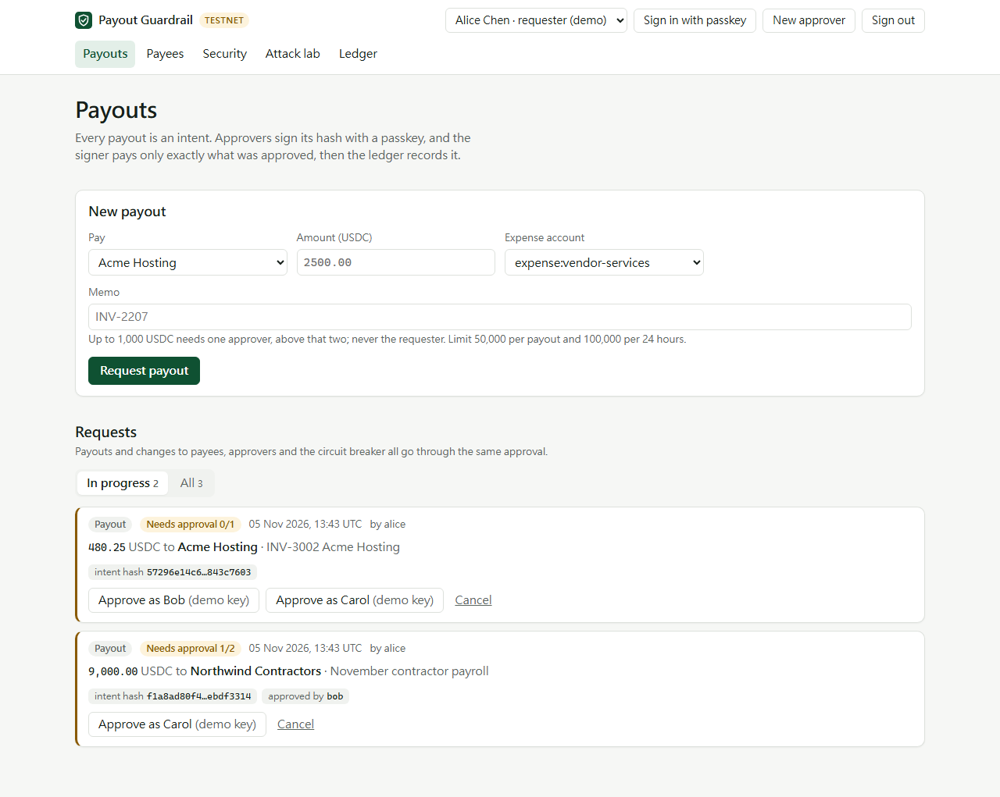
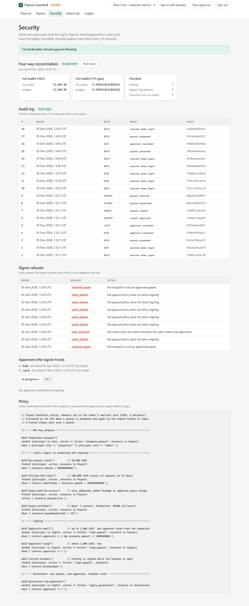

# Payout Guardrail

A self-hostable control plane for **stablecoin payouts**: every outgoing payment is an *intent* that passes a policy, is approved by people signing the intent's hash with passkeys, is executed only if what is signed matches what was approved, and is then reconciled across the intent, the signer's log, the chain and a double-entry ledger.

It is the outbound half of an on-chain money system whose inbound half already exists:
[base-usdc-indexer](https://github.com/BrianLiu0531/base-usdc-indexer) (deposit detection, reorgs, finality) and
[usdc-deposit-ledger](https://github.com/BrianLiu0531/usdc-deposit-ledger) (exactly-once crediting).

> **Testnet only.** This is a reference implementation and portfolio project. It reduces the damage a compromised component can do; it does not make a treasury "hack-proof".

## Status

| Phase | Scope | State |
|---|---|---|
| 1 | Postgres double-entry ledger, property-based tests, read-only ledger API and UI | **Done** |
| 2 | Payout intents, Cedar policy, passkey (WebAuthn) approvals, separate signer, durable worker, sign-in | **Done** |
| 3 | Intent-bound signing, four-way reconciliation, circuit breaker, tamper-evident audit log with signer-held checkpoints, attack lab | **Done** |
| 4 | KMS/HSM signer backend, sanctions screening, Base Sepolia deployment | next |

## Running it

Needs Node 22+ and Docker.

```bash
npm install
docker compose up -d --wait   # PostgreSQL 16 on :5434 and a local EVM chain (anvil) on :8545
npm run seed                  # ledger history, demo token, users, payees, signer bootstrap
npm run dev:signer            # signer on 127.0.0.1:8788 (holds the hot wallet key)
npm run dev:api               # API on 127.0.0.1:8787, with the payout worker and reconciler
npm run dev:web               # http://localhost:5173 (open this)
```

Pick a demo user at the top right: **Alice** requests payouts, **Bob** and **Carol** approve. Their passkeys are software keys kept in `.demo-keys.json` (git-ignored), which is what the "Approve as Bob (demo key)" buttons use. To approve with a real passkey (Windows Hello, Touch ID, a security key), click **New approver**, then have Bob and Carol approve your enrollment.

`npm run demo:reset` wipes the database and chain and seeds again, which you need after the two attacks that leave an incident behind.

| Payouts awaiting passkey approval | Four-way reconciliation and the hash-chained audit log |
|---|---|
|  |  |

## How a payout works

```
 Alice        API (untrusted)          Bob, Carol           Signer (holds the key)            Chain     Ledger
   │ request ──► policy check ──────► passkey signs ──────► recompute hash, verify passkeys,
   │             store intent + hash   SHA-256(intent)      own payee list, own 24h total,
   │                                                         Cedar policy, breaker ─► sign ──► mined ─► posted
   │                                                                                            ▲
   └──────────────── reconciler: intents ⇄ signer log ⇄ on-chain transfers ⇄ ledger balances ──┘
```

1. **Intent.** A payout is a canonical JSON document: chain, token, recipient, amount, payee, memo, requester. Its SHA-256 (with a domain tag) is the intent hash.
2. **Policy at request time.** The API evaluates the Cedar policy (`packages/core/policies/payouts.cedar`): per-payout and rolling 24-hour limits, payee must be active and past its cooling-off period, and only requesters may request.
3. **Approval.** Each approver's passkey signs a WebAuthn challenge that *is* the intent hash, with user verification (PIN or biometric) required. Up to 1,000 USDC needs one approver; above that, two. The requester never counts.
4. **Signing.** The worker sends the intent and the approvals to the signer. The signer trusts none of what the API says. It:
   - recomputes the hash from the fields it is about to act on;
   - verifies every passkey signature against **its own** approver list;
   - checks the recipient against **its own** payee list and cooling-off period;
   - computes the 24-hour total from **its own** append-only log;
   - evaluates the same Cedar policy, including the circuit breaker;
   - builds the ERC-20 transfer itself and signs it.

   Signing is idempotent per intent, and nonces are allocated under a lock.
5. **Broadcast and settle.** The worker broadcasts, waits for confirmations, then posts the payout and the gas fee to the double-entry ledger with fixed idempotency keys. Every step can be retried and repeated safely; there is no Temporal server, the state machine lives in Postgres (`FOR UPDATE SKIP LOCKED`).
6. **Reconciliation** (every 15 s) checks four sources against each other:
   - every signer action has a matching approved intent;
   - every token transfer out of the hot wallet was signed by the signer, for the signed recipient and amount;
   - every settled payout is on chain;
   - hot-wallet USDC and ETH on chain equal the ledger;
   - the audit log's hash chain is intact and matches the checkpoints the signer holds.

   Any unacknowledged critical finding **opens the circuit breaker** in the signer.

Adding a payee, enrolling an approver and closing the breaker are intents too, and each needs two approvers. Closing the breaker also acknowledges the findings that opened it, so a known incident doesn't keep re-tripping it while any new discrepancy still does.

## Attack lab

The **Attack lab** page plays a compromised API server (or worse) against the real signer, chain and ledger. Nothing is mocked, and each attack is also an automated test (`apps/api/test/payouts.test.ts`).

| Attack | Result | Stopped by |
|---|---|---|
| Swap the recipient after approval, including to another approved payee, and claim the old hash | Blocked | Approvals are signatures over the hash; the signer recomputes it |
| Inflate the approved amount | Blocked | Same |
| Replay approvals on a new payout | Blocked | The challenge is bound to one intent |
| Approve with a passkey planted in the API's database | Blocked | Signer's own approver list |
| Requester approves their own payout | Blocked | Requester never counts |
| Approvers tricked into paying a new address | Blocked | Signer's own payee list plus cooling-off |
| 60,000 USDC with two approvals (limit 50,000) | Blocked | Policy `forbid` beats any `permit` |
| Send one approved payout to the signer ten times at once | Blocked | One transaction, one nonce |
| Steal the hot wallet key and transfer directly | **Detected and contained** | Reconciliation finds the unsigned transfer and opens the breaker; the signer then refuses everything until two approvers reset it |
| DB admin edits the audit log and recomputes every later hash | **Detected** | The rewritten chain no longer matches checkpoints held by the signer |

**What this does not do:** a stolen key can still spend whatever the hot wallet holds. Preventing that needs the key in a KMS/HSM, or a smart-account allowance (for example a Safe with a spending limit). This system limits the damage (the hot wallet only holds a float, and the theft halts all payouts within one reconciliation interval) and makes it visible.

## Layout

```
packages/ledger   double-entry ledger library (PostgreSQL)
packages/core     intent hashing, Cedar policy, passkey verification, token ABI (shared by API and signer)
apps/signer       the signer: separate process and schema, the only holder of the hot wallet key
apps/api          HTTP API: sign-in, intents, approvals, worker, reconciliation, audit log, attack lab
apps/web          UI: payouts, payees, security, attack lab, ledger
contracts         MockUSDC (6 decimals) for the local chain
```

## Security notes

- **Trust boundary.** The signer runs as its own process with its own schema. In production, give it its own database and a role the API can't use; here both share one Postgres for convenience. API→signer calls need a bearer token, but holding the token only lets a caller *ask*.
- **Sessions.** Session cookies are HttpOnly and SameSite=Strict, and only a SHA-256 of each session token is stored. Writes that carry a foreign `Origin` are refused. Passkey sign-in and registration require user verification.
- **Demo mode** (`DEMO_MODE`, default on, refused unless the chain id is 31337) allows signing in as demo users without a passkey, and server-held demo keys for Bob and Carol. Every real approval path still goes through WebAuthn verification in both the API and the signer.
- **Append-only** tables: the ledger, the signer's log, refusals and anchors, approvals, and the audit log. Triggers reject UPDATE and DELETE. A database owner can disable triggers, which is exactly what the audit-rewrite attack does, and why checkpoints live with the signer.
- **Keys.** The demo uses anvil's public development keys, and the signer refuses them on any chain other than 31337.

## Ledger UI (`apps/web`)

- **Integrity status:** the server recomputes every balance from the entries; any drift is listed in an alert.
- **Trial balance:** debits and credits per currency, flagged if they ever differ.
- **Accounts:** grouped by type, balances on each account's normal side. Selecting an account filters the journal.
- **Journal:** newest first, keyset-paginated, debits then indented credits. A reversal and the transaction it reverses link to each other, and the reversed one is struck through.
- **Amounts are exact:** formatted from integer strings, never through floating point (tested beyond 2^53).
- Works from 320 px wide (on phones the journal merges debit and credit into one Dr/Cr column), in light and dark mode, and with the keyboard.
- **Content-Security-Policy** in the production build: scripts, styles and requests from `'self'` only, no inline scripts or style attributes. The built app was checked in headless Chrome with no CSP violations. `frame-ancestors` cannot be set in a `<meta>` policy, so whoever hosts the app must send `Content-Security-Policy: frame-ancestors 'none'` and `X-Frame-Options: DENY` as headers.

## API (`apps/api`)

| Endpoint | Returns |
|---|---|
| `GET /v1/ledger/accounts` | Accounts with debits, credits and balance |
| `GET /v1/ledger/trial-balance` | Totals per currency and whether they balance |
| `GET /v1/ledger/transactions?account=&limit=&before=` | Newest first, with `nextCursor` for the next page |
| `GET /v1/ledger/transactions/:id` | One transaction with its entries |
| `GET /v1/ledger/verify` | `{ ok, problems, checkedAt }` |
| `GET /v1/currencies` | Display decimals per currency |

- **The ledger API is read-only by design.** No endpoint posts to the ledger; only the worker does, after a payout settles on chain. A test asserts that `POST`, `PUT`, `PATCH` and `DELETE` on ledger routes all return 404.
- Payout endpoints live under `/v1/auth`, `/v1/payees`, `/v1/intents`, `/v1/security`, `/v1/reconcile`, `/v1/audit` and, in demo mode, `/v1/demo`.
- Amounts are decimal strings, never JSON numbers.
- Unknown query parameters are rejected with 400. Fastify's default is to silently drop them; that default is turned off.
- Errors have a stable shape `{ error: { code, message } }` and never include SQL or stack traces.
- `verify` scans every entry, so concurrent calls share one scan and the result is reused for 5 seconds.
- The API binds to `127.0.0.1`. Put a TLS-terminating proxy in front of it and set `SECURE_COOKIES=true` before exposing it.

## Ledger (`packages/ledger`)

### Model

- **Accounts** have a type (`asset`, `liability`, `equity`, `revenue`, `expense`), a currency, and a flag saying whether their balance may go negative. Amounts are integers in the currency's smallest unit (USDC: 6 decimals) and are `bigint` end to end, never floats.
- **Transactions** hold two or more **entries** (debit or credit). Debits must equal credits **per currency**, so an FX trade needs two balanced legs.
- **Reversals** post the mirror image of a transaction. History is never edited.

### Guarantees and where they are enforced

| Guarantee | Enforced by |
|---|---|
| Every transaction balances per currency and has ≥ 2 entries | Validation in TypeScript **and** deferred constraint triggers checked at `COMMIT`, so a raw SQL insert can't break it either |
| An entry's currency is its account's currency | Composite foreign key `(account_id, currency)` |
| History is append-only | Triggers reject `UPDATE`, `DELETE` and `TRUNCATE` on transactions and entries; accounts can be renamed but not re-typed or deleted |
| A request is applied at most once | `UNIQUE (idempotency_key)` plus a SHA-256 of the canonical request: the same key with the same request returns the original result (`replayed: true`); with a different request it fails with `IDEMPOTENCY_CONFLICT` |
| A transaction is reversed at most once | `UNIQUE (reverses)` |
| Non-negative accounts never go negative, even under concurrency | Balance rows are locked `FOR UPDATE` before the check, in ascending account id order |
| No deadlocks between postings | That same global lock order |
| The balance projection matches the entries | `verify()` recomputes it from the entries in one `REPEATABLE READ` snapshot |

### Why the balance check locks first

A read-then-write check ("is the balance ≥ 10? then debit 10") lets two concurrent withdrawals both pass. Here, the posting locks the balance rows it will change, checks against the locked values, and writes entries and balances in the same transaction. The test suite fires 20 simultaneous withdrawals of 10 against a balance of 100 and requires exactly 10 to succeed.

Locks are always taken in ascending account id order, so an A→B transfer and a B→A transfer can't each hold the lock the other needs.

**Trade-off:** postings that touch the same account are serialised on that account's balance row. For a single hot wallet at high volume, the remedies are sub-accounts or a dedicated engine such as TigerBeetle. That is a deliberate later step, not a hidden limit.

### API

```ts
import pg from 'pg';
import { Ledger, migrate } from '@guardrail/ledger';

const pool = new pg.Pool({ connectionString: process.env.DATABASE_URL });
await migrate(pool);
const ledger = new Ledger(pool);

await ledger.createAccount({ code: 'wallet:hot:base:usdc', name: 'Hot wallet', type: 'asset', currency: 'USDC' });
await ledger.createAccount({ code: 'payable:payouts', name: 'Payouts owed', type: 'liability', currency: 'USDC' });

await ledger.postTransaction({
  idempotencyKey: 'payout-123:settled',
  description: 'Payout 123 settled on-chain',
  entries: [
    { account: 'payable:payouts', direction: 'debit', amount: 250_000000n },
    { account: 'wallet:hot:base:usdc', direction: 'credit', amount: 250_000000n },
  ],
});

await ledger.verify();        // [] when consistent
await ledger.trialBalance();  // debits = credits per currency
```

Errors are `LedgerError` with a `code`: `VALIDATION`, `UNKNOWN_ACCOUNT`, `ACCOUNT_CONFLICT`, `IDEMPOTENCY_CONFLICT`, `INSUFFICIENT_BALANCE`, `ALREADY_REVERSED`, `NOT_FOUND`.

### Tests

```bash
docker compose up -d --wait   # PostgreSQL and anvil
npm test          # 88 tests: ledger, core, signer, API end-to-end, UI. Each database test file gets a fresh database,
                  # and each chain test file its own random hot wallet and freshly deployed token
npm run typecheck
```

- **Core:** canonical intent hashing; the policy's decision and the name of every forbid that fired; passkey checks that reject another intent's signature, unknown credentials, a borrowed identity, a phishing origin, missing user verification and a tampered signature.
- **Signer:** every refusal reason; idempotent concurrent signing; the 24-hour window moving with time; the payee cooling-off period; governance; the circuit breaker; append-only records; anchors.
- **API end-to-end** (real Postgres, real anvil, real signer):
  - request → two approvals → sign → broadcast → settle → ledger → reconciliation agrees to the wei;
  - real passkey registration and enrollment;
  - separation of duties and cross-origin refusal;
  - all ten attacks.

- **Behaviour:** balancing per currency, validation, idempotent replay (including a replay after the balance has been spent), `IDEMPOTENCY_CONFLICT`, overdraft rejection, single reversal, reversal of a reversal refused.
- **Concurrency:** 20 copies of one request applied once; 20 withdrawals against a balance covering 10; 30 transfers in opposite directions without deadlock.
- **Database-level guarantees** (raw SQL, bypassing the `Ledger` class): `UPDATE`/`DELETE`/`TRUNCATE` rejected, an unbalanced or entry-less transaction rejected at `COMMIT`, a currency mismatch rejected by the foreign key.
- **Tamper detection:** a hand-edited balance row is reported by `verify()` and unbalances the trial balance.
- **Model-based property test (fast-check):** random funds, transfers, simultaneous withdrawal bursts, replays and reversals run in concurrent batches. After each run, stored balances must equal the sum of every transaction the ledger reported as committed, no non-negative account may be below zero, and no transaction may be reversed twice. Failures shrink to a minimal sequence. Runs default to 150 (`PROPERTY_RUNS=1000 npm test` for a longer soak).

**The tests were checked against deliberately broken code:**

| Mutation | Caught by |
|---|---|
| Remove `FOR UPDATE` from the balance check | The 20-withdrawal test (all 20 succeed), `verify()` (negative balance), and the property test (8 of 8 runs, each shrunk to a short counterexample) |
| Lock rows one at a time in entry order instead of id order | The opposite-direction test (`deadlock detected`) |

### Operating notes

- Run the application as a database role that has only `SELECT` and `INSERT` on `ledger.transactions` and `ledger.entries` and `UPDATE` on `ledger.balances`. The append-only triggers stop mistakes; table ownership must stay with a separate migration role so the triggers themselves can't be dropped by the application.
- `verify()` scans all entries. Schedule it (for example nightly) and alert on any result.

## Supply chain

- `.npmrc` sets `ignore-scripts=true`; CI installs with `npm ci --ignore-scripts`.
- GitHub Actions are pinned to full commit SHAs, and checkout does not persist credentials.
- CI fails on any `npm audit` finding of moderate severity or above.
- The whole dependency tree, transitive packages included, was resolved with `npm install --before=<two weeks ago>`, so no installed version is newer than two weeks. Docker images are pinned by digest.
- Dependencies are pinned to exact releases that have been public for at least two weeks, not the newest (for example vitest 5.0.5 rather than the 3-day-old 5.1.0, and vite 8.3.5 rather than 8.3.6, published the same day).
